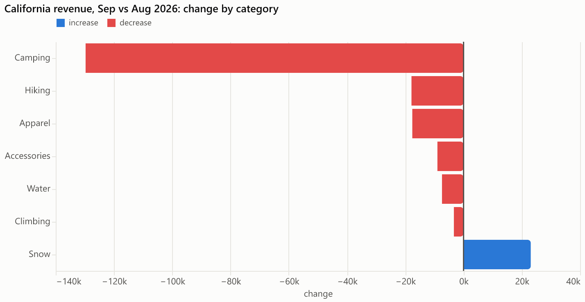
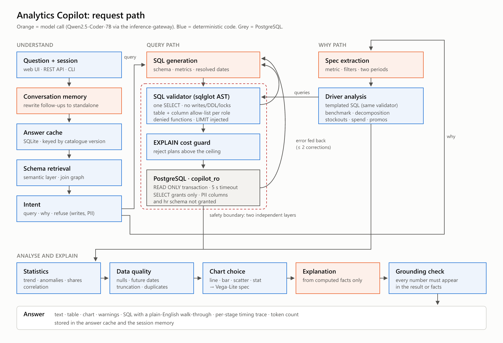

# AI Analytics Copilot

Ask a retail data warehouse questions in plain English and get back a safe SQL query, the
data, statistics, a chart and a short explanation, with every number checked against
the data. Runs on a local 7B model served through my
[inference-gateway](https://github.com/pranavparuchur1/inference-gateway).

```
"Why did revenue decrease in California last month?"

California revenue fell 23.4% (691,372 -> 529,378), against -13.6% in the other states.
Camping explains 80% of the drop while being 33% of August revenue, and coincides with
12 camping products being out of stock in all 5 California stores.
```



## Problem

Business users have questions; the answers sit in a warehouse behind SQL. Text-to-SQL with a
language model closes that gap, but naively it is unsafe (the model can write `DELETE`, read
salaries or e-mail addresses, or run a query that never finishes) and untrustworthy (it can
get the date range wrong, invent a filter, or describe numbers that are not in the data).

This project is a copilot that treats the model as a fast but fallible junior analyst:
**the model proposes, deterministic code decides.**

## Architecture



```
question -> memory (rewrite follow-ups) -> answer cache -> schema retrieval -> intent
  query: SQL generation -> sqlglot validator -> EXPLAIN cost guard -> read-only PostgreSQL role
         (errors fed back to the model, up to 2 corrections)
  why:   spec extraction -> templated decomposition + benchmark + stockout/marketing/promo signals
-> statistics -> data-quality checks -> chart choice -> explanation -> numeric grounding check
```

Details: [architecture/architecture.md](architecture/architecture.md).

## Technology

| Layer | Choice |
|---|---|
| Model | Qwen2.5-Coder-7B-Instruct, AWQ 4-bit, vLLM on an 8 GB RTX 4070 (WSL2) |
| Model serving | [inference-gateway](https://github.com/pranavparuchur1/inference-gateway): API keys, rate limits, usage tracking |
| Warehouse | PostgreSQL 17 (Docker), synthetic retail data (330k orders, 626k lines) |
| SQL safety | sqlglot parse-tree validation + least-privilege database role |
| Analysis | pandas, numpy |
| Charts | Vega-Lite (vega-embed in the UI, vl-convert for PNGs) |
| Service | FastAPI, single-page UI, SQLite caches |
| Tooling | uv, ruff, pytest, Docker, GitHub Actions |

## The data

A seeded generator ([`data/generate.py`](src/analytics_copilot/data/generate.py)) builds two
years and nine months of orders for *Switchback Outfitters*, a fictional outdoor retailer
in 10 states: category seasonality, growth, weekday and holiday effects, store openings, a price
increase, and five **planted effects** so that analytical answers can be checked:

| Effect | What happened | Checked by |
|---|---|---|
| A | Camping products stock out in all California stores, Sept 2026 | "why" questions |
| B | Defective Summit Down Jacket batch, Mar-May 2026 | "why" questions |
| C | FALL25 promotion, Oct-Nov 2025 | promotion signal |
| D | Texas social-media ads paused from June 2026 | "why" questions |
| E | Future-dated orders, zero-quantity lines, duplicate returns, missing states, cost > price | `acp dq` |

## Safety

Generated SQL passes two independent layers before and while it runs:

1. **Validator** ([`safety/validator.py`](src/analytics_copilot/safety/validator.py)), on the
   sqlglot parse tree, not the text: exactly one statement; a query; no write, DDL, `COPY`,
   `SET`, lock or `SELECT INTO` node *anywhere* (catches `WITH d AS (DELETE ...) SELECT`);
   only allowed tables for the user's role; no PII columns; no `pg_*`/`dblink`/`set_config`;
   at least one real table; `LIMIT` injected; an `EXPLAIN` cost ceiling.
2. **Database role** `copilot_ro`: SELECT-only grants, column grants that leave out names,
   e-mail and phone, no access to the `hr` schema, read-only transactions, 5 s timeout.

| Approach (61-statement suite) | Harmful blocked | Harmless wrongly blocked |
|---|---|---|
| Keyword blocklist (`DROP\|DELETE\|UPDATE\|...`) | 18 / 47 | 2 / 14 |
| Parse-tree validator | **47 / 47** | **0 / 14** |

The suite was written alongside the validator, so 47/47 shows the listed attacks are covered,
not that every attack is; that is why the database role exists. `tests/test_db_security.py`
sends `DELETE`, `DROP`, `TRUNCATE` and PII reads straight to the database, bypassing the
validator, with the read-only session default switched off, and the role still refuses them.
Full table: [docs/results/safety.md](docs/results/safety.md).

## Evaluation

[`evaluation/golden.yaml`](evaluation/golden.yaml): 56 SQL questions with hand-written gold
queries (aggregates, relative dates, breakdowns, rankings, trends, comparisons, window
functions, ratios), 8 questions the copilot must refuse, 4 diagnostic "why" questions and 6
follow-up conversations.

**Metric: execution accuracy.** Both the generated and the gold query are run and their
*results* compared (column names ignored, rounding tolerated, extra columns allowed; order
checked only for ranked questions). See [`eval/matching.py`](src/analytics_copilot/eval/matching.py).

**Split discipline.** Prompt work used the 19 dev questions only. The 37 test questions were
run once:

| | Result |
|---|---|
| **Held-out test execution accuracy** | **30/37 = 81%** (95% interval 66-91%) |
| Held-out refusals | 7/8 (one fabricated answer, since fixed) |

Changes made after reading the test failures, then measured on all 56 questions (no longer
held-out):

| Configuration | Execution accuracy (95% interval) | Prompt tokens | p50 / p95 latency |
|---|---|---|---|
| Qwen2.5-Coder-7B, retrieval, self-correction | **49/56 = 87.5%** (76-94%) | 1,594 | 2.0 / 11.5 s |
| same, run again | 49/56 (identical SQL for 55/56) | 1,594 | 2.0 / 12.6 s |
| whole schema in the prompt (no retrieval) | 49/56 = 87.5% | 2,893 | 2.0 / 9.6 s |
| no self-correction | 48/56 = 85.7% | 1,356 | 2.2 / 5.4 s |
| Qwen2.5-Coder-3B | 32/56 = 57.1% (44-69%) | 1,907 | 1.2 / 5.8 s |

What the numbers say, and don't:
- **Model size dominates.** 3B -> 7B is +30 points; every 3B success is also a 7B success.
- **Moving date arithmetic out of the model** was the biggest prompt-side win (dev 79% -> 89%).
- **Schema retrieval** found every needed table in 56/56 questions and saved 45% of prompt
  tokens at equal accuracy. On 8 tables it is a cost saving; it would matter for accuracy
  on a warehouse that doesn't fit in a prompt.
- **Self-correction** raised the share of queries that execute from 89% to 98%, but
  accuracy by one question: it repairs errors the database reports, not wrong logic.
- With 56 questions, differences of 1-2 questions are inside the intervals.

Pipeline results ([docs/results/pipeline.md](docs/results/pipeline.md)):

| Feature | Result |
|---|---|
| "Why" questions: planted driver found | 3/4 |
| Follow-up questions answered correctly | 6/6 |
| Answer-cache hit latency | 0.06 ms vs 1.3 s cold (median) |
| End-to-end latency, 55 golden questions | median 3.2 s, p95 10.3 s (model calls are ~90% of it) |
| Explanation grounding check | 5 of 55 answers flagged: 1 real error caught ("$23,400" for a $161,993 drop), 3 correct derived numbers, 1 unclear ([review](docs/results/grounding_review.md)) |
| Warehouse audit (`acp dq`) | found all 5 planted defect types + 1 unplanted |

Reports: [SQL evaluation](docs/results/sql_eval.md) · [pipeline](docs/results/pipeline.md) ·
[grounding review](docs/results/grounding_review.md) · [data quality](docs/results/data_quality.md) · [safety](docs/results/safety.md) ·
[analysis notebook](notebooks/01_evaluation_analysis.ipynb)

## Design decisions

| Question | Decision | ADR |
|---|---|---|
| Why a parser and a database role, not a keyword filter? | Keyword filter measured at 18/47; the role is an independent second layer | [0001](docs/adr/0001-parse-tree-validation-plus-database-role.md) |
| Why a local 7B model? | No per-query cost, no data leaves the machine; 3B measured 30 points worse | [0002](docs/adr/0002-local-model-behind-the-inference-gateway.md) |
| Why not an agent for "why" questions? | The model extracts a spec; decomposition is deterministic and testable | [0003](docs/adr/0003-why-questions-deterministic-analysis.md) |
| Why execution accuracy and a held-out split? | Text comparison is meaningless; tuning on the test set inflates scores | [0004](docs/adr/0004-execution-accuracy-and-a-held-out-split.md) |
| Why lexical retrieval, not embeddings? | Finds 56/56 needed tables with no extra model or index | [0005](docs/adr/0005-semantic-layer-and-lexical-schema-retrieval.md) |
| Why synthetic data? | Planted effects give "why" answers a ground truth | [0006](docs/adr/0006-synthetic-data-with-planted-effects.md) |

Other choices visible in the code: dates resolved in Python and handed to the model; the
explanation model sees computed facts, not just raw rows; query explanations come from the
syntax tree, not the model; cache keys include a hash of the semantic layer and permissions.

## Failure modes

Observed in evaluation, not hypothetical:

| Failure | Example | Status |
|---|---|---|
| Business vocabulary ignored | "physical stores" became `channel = 'retail'`, dropping outlets (2 questions) | open: definition is in the semantic layer, model ignores it |
| Invented filter | added `channel = 'online'` to a question that never mentioned it | open for SQL; fixed for "why" specs (ungrounded filters dropped) |
| Wrong grain | revenue per marketing dollar per state *per month* when asked per state | open |
| Fabricated answer | weather question -> `SELECT 'Sunny' AS weather` | fixed: queries must read a table |
| Ambiguous period | "spring 2026" read as March vs February, hiding a year-over-year defect spike | open: missed 1 of 4 "why" questions |
| Wrong number in prose | explanation said a $23,400 drop for a $161,993 drop | caught by the grounding check and shown as a warning; not prevented |
| Benchmark misread in prose | "Texas orders -4.1% vs a 30.4% increase in 2025" when +30.4% is the *other states* | open: the "why" facts label the benchmark, the model still paraphrases it wrongly; small changes also produce noisy top segments (headlamps) |
| Misleading share | "34% of total revenue" computed from the top-5 rows only | fixed: no shares for top-N results |
| Correction loop stalls | ambiguous column error not repaired in 3 attempts | open |

Model-independent risks: the semantic layer must be maintained by people who know the
business; the rule-based intent classifier will miss unusual phrasings of restricted requests
(the validator and the database role still block the data); the synthetic data is cleaner
than real data.

## Scaling

| Pressure | What changes |
|---|---|
| Hundreds of tables | Retrieval becomes essential: add embedding search over table/column docs alongside the lexical score; keep join-graph closure |
| Many users | The API is stateless except memory and caches: move both to Redis/Postgres; run several API replicas behind a load balancer |
| Model throughput | vLLM batches concurrent requests; the gateway already does routing and admission control; add GPUs or a hosted fallback tier |
| Heavy queries | Point `copilot_ro` at a read replica; keep the EXPLAIN ceiling and timeout; pre-aggregate common metrics |
| Governance | Per-user roles from SSO instead of a request field; row-level security policies in PostgreSQL; audit log of question -> SQL -> rows returned |

## Future improvements

- Turn the semantic layer's business terms into enforced rewrites ("physical store" ->
  `channel <> 'online'`) instead of hoping the model reads the description.
- Self-consistency: generate 3 queries and run the majority result, measured against the
  current single-query accuracy.
- Ask a clarifying question when the period or metric is ambiguous instead of guessing.
- Year-over-year as the default baseline for seasonal metrics in "why" questions.
- A larger golden set (200+) so ablation differences become measurable, and a hosted model
  as a comparison point.

## Quickstart

Requires Docker, [uv](https://docs.astral.sh/uv/), and for the model, WSL2 with an NVIDIA GPU
and a checkout of the inference-gateway at `~/inference-gateway`.

```bash
cp .env.example .env
make install          # Python dependencies
make db-up            # PostgreSQL with the schema and the read-only role
make seed             # synthetic data (about 45 s)
make test             # 127 tests; no model needed (a scripted fake model is used)
make llm              # start Qwen2.5-Coder-7B + the gateway in WSL
```

Create a gateway key for the copilot and put it in `.env` as `LLM_API_KEY` (from the gateway
checkout: `IGW_CONFIG=<this repo>/infrastructure/gateway/copilot.toml uv run igw keys create copilot`).
Then:

```bash
make serve                                               # http://localhost:8765
uv run acp ask "What were our top five products by revenue last quarter?"
make eval-test                                           # held-out split
make eval-pipeline                                       # why / memory / cache / explanations
make dq                                                  # warehouse audit
```

## Repository layout

```
architecture/        diagram (SVG + PNG) and architecture notes
configs/             semantic layer, access policy, sample values
docker/              how the containers fit together
docs/                ADRs, results, beginner's guide (docs/learn/guide.md), images
evaluation/          golden questions, conversations, safety suite, saved runs
infrastructure/      PostgreSQL schema + read-only role; gateway config for the copilot
notebooks/           evaluation analysis
scripts/             evaluation, reports, model serving helpers
src/analytics_copilot/
  safety/            validator and read-only executor
  schema/            catalogue and schema retrieval
  analysis/          profiling, statistics, data quality, charts, diagnostics
  eval/              result matching and the golden-set runner
  copilot.py         the pipeline; api.py + web/ the service and UI
tests/               127 tests (validator, database security, matching, pipeline with a fake model)
```
