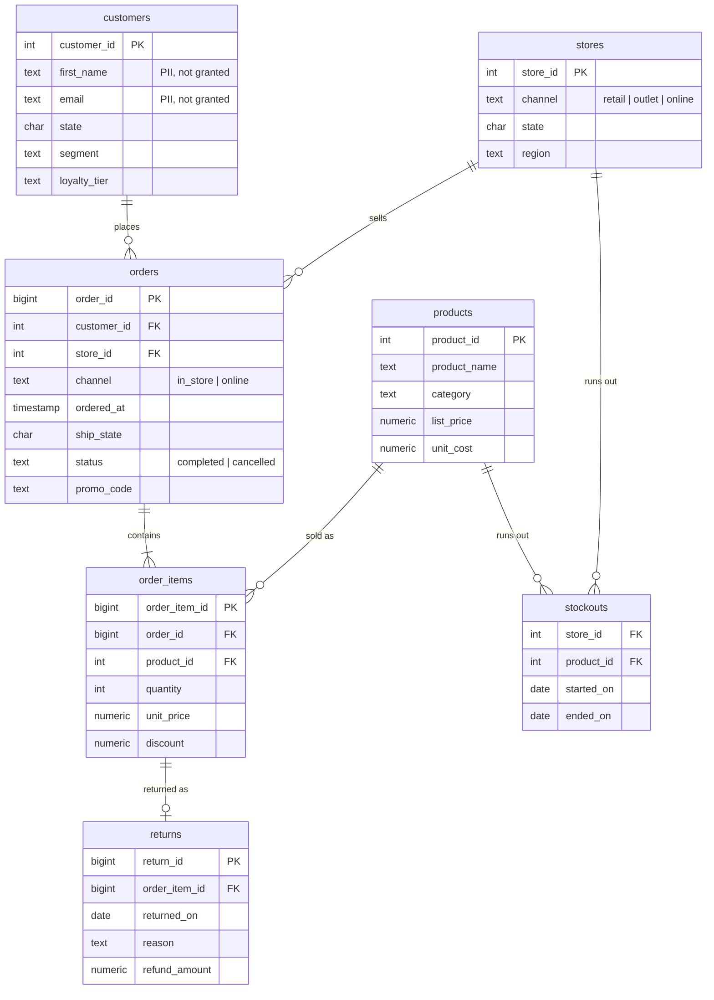

# Architecture


The diagram source is [`architecture.svg`](architecture.svg); the PNG is rendered from it.

## Design principle: the model proposes, code decides

The language model is used for four narrow jobs, each one checked by deterministic code:

| Model job | What checks it |
|---|---|
| Rewrite a follow-up into a standalone question | Intent rules run on both the original and the rewrite; a refusal on either one wins |
| Write SQL | sqlglot validator, EXPLAIN cost guard, then a database role that can only read |
| Extract a "why" spec (metric, filters, periods) | Whitelisted fields and metrics; filters whose value the question never mentions are dropped |
| Write the explanation | It only sees computed facts; every number it writes is matched against the result |

Everything else (dates, statistics, chart choice, data-quality checks, driver analysis,
query explanation) is ordinary code with unit tests.

## Components

| Module | Responsibility |
|---|---|
| `copilot.py` | Orchestrates one request; records per-stage timings and tokens |
| `memory.py` | Last 5 turns per session; follow-up detection and rewriting |
| `cache.py` | SQLite answer cache and SQL-result cache, both keyed by a hash of the semantic layer, policy and sample values |
| `schema/catalog.py` | Column types parsed from the DDL with sqlglot, descriptions and metrics from `configs/semantic_layer.yaml`, sample values from the database |
| `schema/retrieval.py` | Scores tables against the question (names, synonyms, columns, values, metric words) and closes the selection over the join graph |
| `intent.py` | Routes to query / diagnose / refuse with rules |
| `dates.py` | Resolves "last quarter" etc. to exact ranges for the prompt |
| `sqlgen.py` | Prompt, SQL extraction, validation, execution, error-feedback loop |
| `safety/validator.py` | Parse-tree checks (below) and LIMIT injection |
| `safety/executor.py` | `copilot_ro` connection, read-only transaction, statement timeout, EXPLAIN cost guard |
| `analysis/profile.py`, `stats.py` | Column roles (time / measure / dimension) and computed facts |
| `analysis/quality.py` | Per-result warnings and the warehouse audit (`acp dq`) |
| `analysis/charts.py` | Chart form from result shape; Vega-Lite spec |
| `analysis/diagnose.py` | Spec extraction, templated decomposition, benchmark, related signals |
| `explain.py` | Query walk-through from the AST; answer text; numeric grounding check |
| `api.py`, `web/index.html` | FastAPI endpoints and the single-page UI |
| `eval/` | Result matching and the golden-set runner |

## Safety layers

```
generated SQL
  -> sqlglot parse            exactly one statement; must be a SELECT / set operation
  -> tree walk                no INSERT/UPDATE/DELETE/MERGE/DDL/COPY/SET/LOCK/SELECT INTO
                              anywhere, including inside CTEs (WITH x AS (DELETE ...))
  -> tables                   only the retail schema; only tables allowed for the user's role
  -> columns                  restricted columns (names, email, phone, salary, ssn) rejected;
                              SELECT * rejected when customers is involved
  -> functions                pg_*, dblink, lo_*, set_config, nextval ... rejected
  -> data source              at least one warehouse table (no made-up constants)
  -> LIMIT                    added, or capped at 1000
  -> EXPLAIN                  estimated cost above 2,000,000 rejected before running
  -> PostgreSQL               role copilot_ro: SELECT grants only, column grants hide PII,
                              no hr schema, READ ONLY transaction, 5 s statement_timeout
```

The validator and the role are independent: `tests/test_db_security.py` sends harmful SQL
straight to the database (bypassing the validator) and checks the role refuses it, including
with the read-only session default switched off.

## Data model



`marketing_spend (spend_date, channel, state, amount)` joins to orders by state and date, and
`hr.employees` exists only to prove the copilot cannot read it.

## Deployment shape

```
Windows host
├── Docker Desktop
│   ├── warehouse   postgres:17-alpine, port 5433
│   └── copilot     (optional) API + UI, port 8765
└── WSL2 Ubuntu (GPU)
    ├── vLLM worker   Qwen2.5-Coder-7B-Instruct-AWQ, port 8011
    └── inference-gateway  auth, rate limits, usage tracking, port 8000
```

The gateway is the project in `github.com/pranavparuchur1/inference-gateway`; the copilot is
just another API-key holder there, so its token usage shows up in the gateway's `/v1/usage`.
